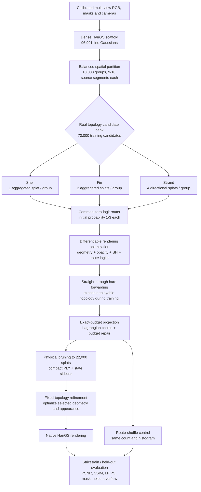

# UniFur

## Latest static milestone: known-surface 3DGS → Shell / Strand

Both [A025 oracle-surface routes](experiments/a025_oracle_surface_routes_20261017/docs/README.md)
are archived: free 3DGS followed by routing, and routed primitives from birth.
**These are static reconstruction experiments, NOT physically simulatable assets.**
Surface initialization, route labels and connected endpoints do not provide moving
surface anchors, collisions or a validated physical solver. The newly approved
surface-binding work is separate and is not included in this milestone.
The study uses an explicitly authorized known naked-body prior, not an
image-estimated prior; it must not be compared with older A025 datasets as if the
protocol were unchanged. The historical sections below describe earlier versions.

## Current experimental pipeline: teacher-free Shell / Strand

The current animal-reconstruction prototype is
[teacher_free_shell_strand_v1](hairgs_hybrid/teacher_free_shell_strand_v1/README.md).
It initializes its own learnable support from training RGB, cameras and alpha,
fits Shell at 512, then opens evidence-driven Strand birth at 1024 and refinement
at 2048. It does **not** consume a trained HairGS model, teacher loss, MVS point
bank, Fin branch or residual branch. HairGS supplies the native rasterizer and
Gaussian-optimization principles, not reconstructed training targets.

See the [method contract](hairgs_hybrid/TEACHER_FREE_LOD_CONTRACT.md) and the
module's frozen run configuration. The A050 tail-v3 8,000-step run and both
HairGS controls are complete. **This update does not demonstrate an overall
improvement over equal-budget GS (the HairGS compressed-finetune control).**
At 64,717 rendered primitives, ours has slightly higher test foreground PSNR
and lower missing-foreground area, but worse full PSNR, masked SSIM/LPIPS,
overflow and measured FPS. See the [verified result and limitations](reports/a050_tail_v3_20260909.md).

This is a matched deployed-count comparison, not an identical-training-budget
ablation: ours trains at 512 -> 1024 -> 2048 with SH degree 2; HairGS trains at
native 2048 with SH degree 3, and its compact control starts from the unrestricted
616,005-GS model, then compresses and fine-tunes for 8,000 steps. These results
must not be mixed with the historical benchmark below.

## Historical compression milestone (not the current initialization)

UniFur learns a compact, spatially adaptive Shell/Fin/Strand Gaussian topology
on top of a calibrated multi-view HairGS scaffold.  The maintained milestone is
the Panda 28-fit / 8-held-out experiment at 480x270 with a final budget of
22,000 splats.

## Pipeline



### 1. Dense scaffold and grouping

The input is a fitted HairGS line-Gaussian scaffold with calibrated cameras.
Panda contains 96,991 source segments.  A deterministic balanced spatial
partition creates 10,000 local groups with 9-10 segments each.  This makes route
decisions local and prevents dense image regions from monopolizing the budget.

### 2. Real topology candidates

Each group represents the same source optical mass in three ways:

| Route | Cost | Intended role |
|---|---:|---|
| Shell | 1 splat | broad, low-cost regional coverage |
| Fin | 2 splats | silhouette and transition support |
| Strand | 4 splats | directional and high-frequency detail |

The 70k candidate bank is only a differentiable search space.  It is never
reported as the deployed model.

### 3. Common-start adaptive routing

Every group starts from route logits `[0, 0, 0]`, hence probabilities
`[1/3, 1/3, 1/3]`.  There is no Panda-specific Shell/Fin/Strand quota.  RGB,
bidirectional mask supervision, topology cost, and reconstruction gradients
jointly optimize:

- route logits;
- Gaussian position and line endpoints;
- scale and orientation;
- opacity;
- spherical-harmonic appearance;
- route-specific shape strength and roll.

The router uses real route costs `[1, 2, 4]`.  Its budget loss therefore tracks
expected active splats rather than a label-count proxy.

### 4. Hard projection and compact refinement

Hardening selects one topology per group and repairs the assignment to exactly
22,000 active splats.  Unselected candidates are physically removed.  The
selected topology is frozen for compact refinement, while its geometry,
opacity, orientation, scale, and SH appearance remain trainable.

The learned Panda allocation is:

| Route | Groups | Group share | Deployed splats | Splat share |
|---|---:|---:|---:|---:|
| Shell | 4,470 | 44.70% | 4,470 | 20.32% |
| Fin | 2,295 | 22.95% | 4,590 | 20.86% |
| Strand | 3,235 | 32.35% | 12,940 | 58.82% |

### 5. Evaluation and attribution

All methods use the same 28 fit views, 8 held-out views, resolution, cameras,
alpha semantics, renderer, and self-contained evaluator.  A route-shuffle
control preserves both the exact 22k count and learned route histogram but
reassigns the routes to different spatial groups.

## Panda milestone

| Method | splats | held-out FG PSNR | Full PSNR | masked LPIPS | deploy size | FPS |
|---|---:|---:|---:|---:|---:|---:|
| HairGS full | 96,991 | **20.3245** | 26.3744 | **0.0711** | 26.77 MB | 209.0 |
| HairGS equal-count | 22,000 | 19.7876 | 26.0876 | 0.0860 | **6.07 MB** | **277.0** |
| **UniFur topology + refinement** | **22,000** | **20.0893** | **26.9131** | 0.0907 | 6.11 MB | 250.7 |
| route-shuffle control | 22,000 | 15.5609 | - | - | 6.11 MB | - |

At equal count, UniFur improves foreground PSNR by 0.302 dB and full PSNR by
0.825 dB over HairGS.  Against full HairGS, it retains foreground PSNR within
0.235 dB, reduces deployment bytes by 77.18%, and raises measured throughput
from 209.0 to 250.7 FPS.  Route shuffling reduces foreground PSNR by 4.528 dB,
showing that spatial ownership—not only the global route ratio—matters.

Optimization wall time is not a claim of this milestone.  Full HairGS remains
better in masked LPIPS and fine-fiber fidelity.  Detailed metrics and claim
limits are recorded in
[`hairgs_hybrid/TOPOLOGY_ROUTER_MILESTONE.md`](hairgs_hybrid/TOPOLOGY_ROUTER_MILESTONE.md).

## Animals60 dense-teacher compression milestone

The multi-case extension has been audited on eight Animals60 subjects under a
common 48-fit / 12-held-out, 512x512 protocol. At 75% compression, UniFur
averages 112,930 deployed segments, 29.86 MiB and 251.59 FPS, while reducing
false-positive area on every case relative to equal-budget HairGS. Its
foreground PSNR is still 2.350 dB lower than equal-budget HairGS; the higher
full-image PSNR comes from reduced background leakage rather than better
foreground appearance. Protocol, complete tables and claim boundaries are in
[`hairgs_hybrid/ANIMALS60_DENSE_TEACHER_MILESTONE.md`](hairgs_hybrid/ANIMALS60_DENSE_TEACHER_MILESTONE.md).

## Repository layout

```text
hairgs_hybrid/
  build_topology_candidate_bank.py  balanced grouping and 1/2/4 candidates
  scaffold_io.py                    minimal HairGS line-scaffold PLY I/O
  hybrid_model.py                   differentiable topology router
  train_hybrid.py                   reconstruction and route optimization
  harden_topology_checkpoint.py     exact-budget physical pruning
  render_hybrid.py                  native HairGS rendering adapter
  benchmark_render.py               deployment throughput measurement
  prepare_panda_hairgs.py           frozen Panda HairGS protocol conversion
  prepare_hair_mask_manifest.py     immutable mask/provenance validation
  run_panda_hairgs_hybrid.sh        shared training/evaluation stage
  run_panda_topology_router.sh      candidate search and hard projection
  refine_panda_hard_topology.sh     fixed-topology refinement
  audit_panda_topology_experiment.py strict table and visual comparison
scripts/
  export_hairgs_external_renders.py renderer-to-evaluator manifest adapter
  evaluate_external_renders.py      self-contained unified image evaluator
  setup_hairgs_baseline.sh          pinned upstream HairGS environment
third_party/
  hair-gs/                           upstream HairGS Git submodule
requirements/
  cuda118.txt                        PyTorch/CUDA ABI pins
  pytorch3d-cu118.txt                PyTorch3D wheel and ABI pin
  runtime.txt                        pinned Python runtime
  dev.txt                            validation/test dependencies
tests/
  test_topology_router.py
  test_hairgs_compact_state.py
  test_hairgs_inference_config.py
  test_external_evaluator.py
```

## Setup

The maintained code extends upstream HairGS commit
`16588656b1f6f048bc3bc83f3cb98c2da8596754`.  HairGS is tracked as the
`third_party/hair-gs` Git submodule; UniFur does not vendor or silently patch
its CUDA rasterizer.

Prerequisites are Linux or WSL2, an NVIDIA GPU/driver, the CUDA 11.8 toolkit,
Conda, and Git.  The validated Python ABI is 3.10.

```bash
git clone --recurse-submodules https://github.com/houguanli/UniFur.git
cd UniFur
bash scripts/setup_hairgs_baseline.sh
```

For an existing clone, initialize the dependency with
`git submodule update --init --recursive`.  All runners resolve HairGS from
`third_party/hair-gs` by default, independent of the checkout location.
The installer creates the `unifur` environment by default, consumes the pinned
files under `requirements/`, builds all three native extensions from the
submodule, exercises CUDA forward/backward, runs `pip check`, and executes the
test suite.  `CONDA_ENV`, `CONDA_BIN`, `CUDA_HOME`, and `HAIRGS_ROOT` remain
explicit overrides.

Datasets and experiment outputs are intentionally not part of the source
repository.  Runners default to `data/` and `outputs/` inside the checkout;
external storage can be selected without editing code:

```bash
export UNIFUR_DATA_ROOT=/path/to/unifur_data
export UNIFUR_OUTPUT_ROOT=/path/to/unifur_outputs
```

To re-run the dependency and CUDA integrity check independently:

```bash
PYTHONPATH=compat/hairgs_sitecustomize:third_party/hair-gs:. \
  conda run --no-capture-output -n unifur \
  python scripts/verify_reproducibility.py
```

## Reproduce

```bash
# Candidate construction, soft/ST training, exact hard projection,
# learned-route and route-shuffle evaluation.
bash hairgs_hybrid/run_panda_topology_router.sh

# Fixed 22k topology refinement and final train/held-out evaluation.
bash hairgs_hybrid/refine_panda_hard_topology.sh

# Rebuild the final numeric table and train/test montages.
python hairgs_hybrid/audit_panda_topology_experiment.py \
  --benchmark-root /path/to/hairgs_hybrid_outputs \
  --output-root /path/to/final_audit \
  --panda-root /path/to/panda_observations
```

The runners refuse ambiguous restarts and duplicate GPU training.  Datasets,
checkpoints, renders, logs, and audit outputs remain outside Git.

## Retained local outputs

The cleaned Panda benchmark root keeps only:

```text
panda_protocol_r480/                         frozen data/camera protocol
panda_native_hairgs_5k_v1/                  full 96,991-splat reference
compression_sweep_panda_fine_v1/            equal-count 22k HairGS reference
panda_topology_g10k_st_hard22k_v2/          direct hard diagnostic
panda_topology_g10k_st_hard22k_refine3k_v3/ final model and audit
panda_topology_g10k_st_hard22k_route_shuffle_v2/ attribution control
```

Only final checkpoints, unified evaluation manifests/arrays, audit reports, and
comparison images are retained.  Candidate banks, soft checkpoints, native
temporary render folders, smoke runs, failed runs, and superseded ablations are
regenerable and intentionally removed.

## Validation

Run the maintained tests in the HairGS environment:

```bash
PYTHONPATH=compat/hairgs_sitecustomize:third_party/hair-gs:. \
  conda run --no-capture-output -n unifur python -m pytest -q
```

## Claim boundary

- Shell/Fin/Strand are different Gaussian topologies, but are not literal
  volumetric shells, ribbon meshes, or continuous simulation-ready fibers.
- The result supports compact quality retention and meaningful adaptive spatial
  ownership, not lossless compression.
- The result does not claim optimization-time superiority.
- Full HairGS retains better perceptual/high-frequency quality.
- One requested Panda seed is reported; no variance claim is made.
