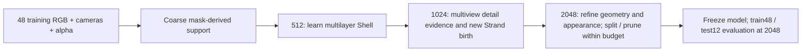

# Teacher-free LOD Shell / Strand reconstruction

Status: contract for the completed A050 tail-v3 teacher-free experiment; the
2026-09-09 result does not demonstrate an overall improvement over equal-count
HairGS. See the [verified report](../reports/a050_tail_v3_20260909.md). The user
authorized publishing the verified current version; no new training or deletion
is authorized by this document. Teacher-dependent initialization remains excluded
from this method (the independent HairGS comparator is documented separately).

## Main pipeline

There is **no trained HairGS model, teacher loss, converted teacher PLY, MVS point pool, reserve candidate bank or teacher color fit** in the method's initialization or training. HairGS is a source of rasterization / Gaussian optimization mechanisms and an independent comparator, never an input to this model. Initial Strand count is zero; subsequent curves must be real new optimizable geometry.

## Input and initialization

- Dataset: `F:/fur_hair_unified_data/benchmarks/unifur_animals_a050_tail_v3_20260908`.
- Release SHA256: `ead4c84d8c765d89bb03fd83d424373f0568395832d449816627a77334c10454`.
- Training allowlist SHA256: `9ea1a66b2a5c0d691395246f09c9325e4535cb0b0b306e9e6ada82721659fc88`.
- Use only the 48 allowed RGB images, known camera matrices and their foreground alpha. Test images, Position/depth/normal passes, GT body/hair decomposition, asset mesh and dense strand GT are evaluation-only.
- A low-resolution visual hull from these observations is an allowable geometric initialization. It is an outer-envelope approximation, **not recovered skin or a ground-truth root surface**. Derive the finite search domain from cameras and silhouette rays; do not read GT bounds. Detect empty/unbounded/clipped support instead of silently inventing geometry.
- Shell roots, depth/thickness and geometry remain learnable. Initialization should not permanently lock primitives to an erroneous envelope. Record hull resolution and its limitations, particularly thin tail structures and concavities.
- Area-average the original RGB composite and alpha separately for each LOD. Never multiply already-composited RGB by alpha again. Intrinsics/projection must match the resolution and pixel-center convention.

## Representation and optimization

| Branch | Geometry | Appearance | Topology |
|---|---|---|---|
| Shell | Root plus ordered offsets along a learnable local normal; Gaussian footprints predominantly tangent to the support; positive layer spacing and finite thickness | Learn DC, opacity and footprint scales; high-order SH disabled in coarse fitting | Refine/split entire coherent columns, prune only with retained coverage evidence |
| Strand | Connected curve with movable root/control points; segment Gaussians align with the **local curve tangent**, not a fixed body normal | Learn DC/SH, per-segment opacity and transverse scales; nonzero small initial opacity | Birth after coarse warmup, variable segment count through local split/growth, prune with consistent connectivity |

No Fin or Residual branch. No case-specific fixed Shell/Strand proportion. Structural membership plus actual birth/prune decisions determine the distribution, rather than selecting a subset of a prelearned teacher.

Borrow the HairGS/3DGS optimization principles: differentiable rasterization, independent appearance/geometry learning rates, screen-space error/gradient-driven refinement, and correct Adam-state extension/removal for topology changes. Reinitializing every existing optimizer state after a birth is not equivalent.

2D hair orientation is generally an unoriented line observation. Root-to-tip signs must not be claimed as directly observed without additional evidence. A normal component at the root and subsequent curvature are allowed; local tangent alignment does not constrain an entire curve to a flat surface plane.

## LOD and supervision

1. **512 Shell warmup:** optimize low-frequency RGB and both directions of silhouette error (missing foreground and excess outside foreground). Strand parameters/candidates do not yet exist. Monitor complete training-view passes, not one sampled view.
2. **1024 transition:** increase Strand availability smoothly. Use current multi-view high-frequency / foreground-deficit evidence to propose new 3D curves; require positive-depth, mask and geometric consistency across available training observations. No arbitrary random long strands to fill a count target. Keep low-frequency Shell correction with reduced learning rate; do not freeze a visibly incorrect coarse surface.
3. **2048 refinement:** optimize joint full-resolution rendering plus branch-appropriate supervision. Attribute detail credit to Strand using a detail or leave-one-route-out diagnostic; do not reward route count or opacity mass alone. Local curve refinement increases segments where supported, including curvature/high projected extent. Prune excess or unhelpful geometry with multi-view evidence.

Exact stage boundaries, weights, proposed split criteria and safety thresholds belong in one frozen run configuration before starting. They are method settings, not properties of the animal. Resolution changes alter loss scale: do not interpret the stage-boundary jump as a convergence failure.

The current experimental primitive cap is **239,171**, not a promised 75% ratio and not a required exact fill. Count each actually rasterized Shell Gaussian and Strand segment; do not count endpoints as additional Gaussians. Log unused capacity and births/splits/prunes by branch. Empty initial Strand arrays are not an excuse for dead zero-opacity gradients at birth.

## Minimum executable acceptance

- Deny teacher/MVS/GT/test inputs, including indirect helpers and cached defaults. Snapshot source hashes. Step-zero artifact must show Shell-only geometry and zero Strand primitives.
- Synthetic camera and area-pooling checks, alpha-compositing checks, nonempty hull / orientation / ordered-layer checks.
- CPU model tests show position/control-point, normal/rotation, scale, DC/SH and opacity gradients where enabled, and disabled high-order Shell SH.
- Actual birth adds curves and optimizer state, split adds segments, pruning preserves remaining state/connectivity, and no event exceeds the cap. Tests exercise full capacity, not just the happy path.
- Checkpoints must state exactly what is saved. If continuous resume is supported, include optimizer, topology, stage, RNG and view-sampling state and test a resume against uninterrupted continuation; otherwise explicitly prohibit claiming strict resume.
- GPU smoke covers 512/1024/2048, native forward/backward, real topology events and finite values. CPU property tests are not proof of a working rasterizer. Smoke outputs are not training initialization or formal metrics.
- Main experiment runs only after source/protocol tests and smoke pass. One GPU owner; do not terminate unrelated UE processes. Measure allocated, reserved and device memory separately; no silent reduction of image size, point budget or quality settings.

## Evaluation and handoff

Freeze the model before using test12. Render training48 and test12 at 2048 with the same background/alpha semantics and existing external evaluator. Report foreground/full PSNR, masked SSIM/LPIPS, IoU, FN/FP and largest holes/spill; include fixed train/test visual comparisons, not only favorable examples.

Inspect 3D primitive geometry and root/layer/curve distributions, scale/opacity/SH statistics, birth/prune history and leave-one-branch-out contributions. Report actual primitive count, file sizes, render speed, train peak memory and complete wall time, including this method's own hull initialization but **not unrelated obsolete teacher work**. Account for sunk diagnostic work separately.

HairGS and traditional 3DGS may be evaluated independently on the same new data. They must never initialize this model. An unrestricted comparator with different initialization or step count is not a single-variable causal ablation. OTC metrics require their own validated representation-to-measure conversion and accepted GT; do not infer geometry scores from RGB improvement.

Old runs are preserved as diagnostics. Completing training and image evaluation
does not establish reconstruction-quality superiority or validated Fur-OTC
geometry. The current result has not passed that quality claim.
